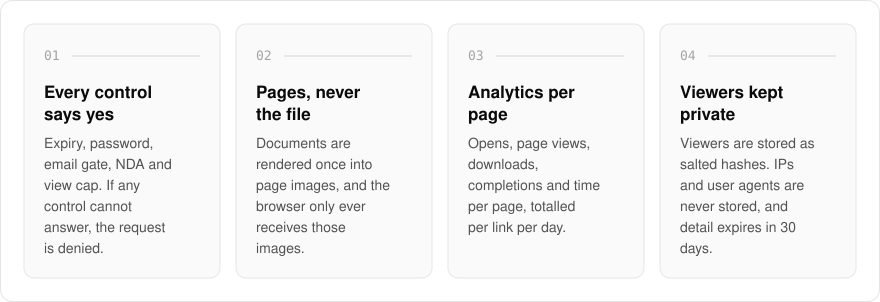
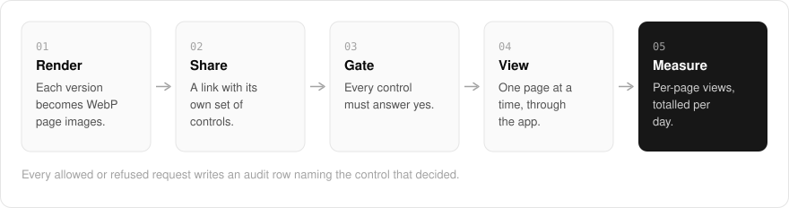

  <picture>
    <source media="(prefers-color-scheme: dark)" srcset=".github/assets/hero-dark.png">
    
  </picture>

<h1 align="center">show.me.at</h1>

<strong>Share a document without sending the file.</strong>

  
  
  
  

  <a href="#features">Features</a> ·
  <a href="#how-it-works">How it works</a> ·
  <a href="#built-with">Built with</a>

Once you email a PDF, you have no say in who reads it and no way to know whether anyone did. I built show.me.at so you share a link instead of the file: each document is rendered once into page images, and a recipient gets one page at a time after every control on the link says yes. If any control cannot give an answer, the request is denied. It is for a deck or PDF you want watched, not just moved, with data rooms for whole collections.

> **Status:** the back end is built and tested, but the site has no database, file storage or email verification behind it yet, so sharing is not usable, and there is no browser upload form yet.

  <picture>
    <source media="(prefers-color-scheme: dark)" srcset=".github/assets/overview-dark.svg">
    
  </picture>

## Why show.me.at

| The usual file share | show.me.at |
| --- | --- |
| Sends the file | Serves page images, one page at a time, through the app |
| A link works until someone revokes it | Expiry, password, email gate, NDA and a view cap on every link |
| An unclear check lets the visitor in | A control that cannot answer denies the request |
| You know it was opened, at best | Page views, completions and time per page |
| Logs IP addresses and user agents | Salted viewer hashes, with reading detail expiring after thirty days |

## Features

- **Per-link controls**: expiry date, password, email gate with an optional domain allowlist, NDA click-through, a download switch (off by default) and an always-on view cap.
- **Fail-closed access checks**: a request is allowed only when every control answers yes, and every allowed or refused request writes an audit row naming the control that decided.
- **Page images, rendered once per version**: documents are rendered to WebP page images, and the browser only ever receives those images.
- **Encrypted at rest**: files are stored as AES-256-GCM envelopes and every page is served through the app, never through a presigned storage URL.
- **Page-level analytics**: opens, page views, downloads, completions and time per page, totalled per link per day.
- **Privacy-minded viewer tracking**: viewers are stored as salted hashes, and IP addresses and user agents are never stored. Detailed reading rows expire after thirty days.
- **Data rooms**: foldered collections with viewer-level permissions and an access audit trail (the paid tier).

## How it works

  <picture>
    <source media="(prefers-color-scheme: dark)" srcset=".github/assets/flow-dark.svg">
    
  </picture>

Each version of a document is rendered once into WebP page images by a background worker. A share link carries its own controls, and every page request runs through all of them; only when each one answers yes does the app stream that page. Views are recorded per page and totalled per link per day, and every decision, allowed or refused, lands in the audit trail.

## Built with

  
  
  
  
  
  

- Next.js 16 (App Router), React 19, TypeScript
- Tailwind CSS 4
- Drizzle ORM + Postgres
- Better Auth
- oRPC + TanStack Query
- BullMQ + Redis for document rendering, pdf.js and @napi-rs/canvas for page images
- S3-compatible object storage, Upstash rate limiting, Resend for gate emails

## Part of the me.at family

show.me.at is one of my [`*.me.at`](https://me.at) apps. They share one design system, account, and app shell. Development happens in a private monorepo; this repository is the project's public-facing home.

## License

Source-available. See [LICENSE](LICENSE).
