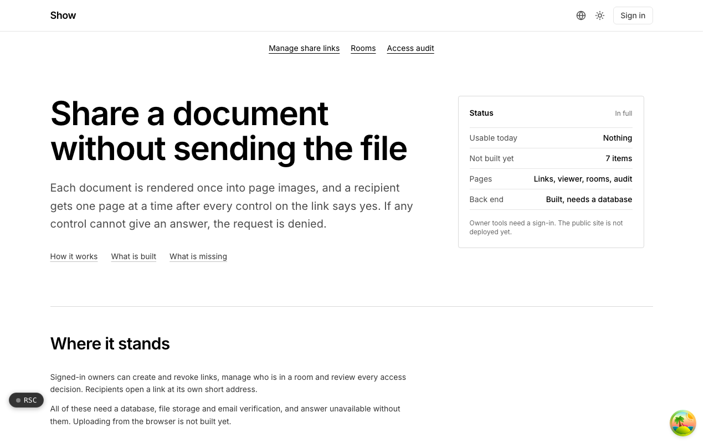

  <picture>
    <source media="(prefers-color-scheme: dark)" srcset=".github/assets/hero-dark.png">
    
  </picture>

# show.me.at

Share a document without sending the file.

show.me.at is secure document sharing with per-link controls and page-level view analytics, plus data rooms. Each document is rendered once into page images, and a recipient gets one page at a time after every control on the link says yes; if any control cannot give an answer, the request is denied. It is for people who want a deck or PDF to be watched, not just moved. The back end is built and tested, but the public site is not deployed yet: it needs a database, file storage and email verification before anything is usable, and there is no browser upload form yet.

## Features

- **Per-link controls**: expiry date, password, email gate with an optional domain allowlist, NDA click-through, a download switch (off by default) and an always-on view cap.
- **Fail-closed access checks**: a request is allowed only when every control answers yes, and every allowed or refused request writes an audit row naming the control that decided.
- **Page images, rendered once per version**: documents are rendered to WebP page images, and the browser only ever receives those images.
- **Encrypted at rest**: files are stored as AES-256-GCM envelopes and every page is served through the app, never through a presigned storage URL.
- **Page-level analytics**: opens, page views, downloads, completions and time per page, totalled per link per day.
- **Privacy-minded viewer tracking**: viewers are stored as salted hashes, and IP addresses and user agents are never stored. Detailed reading rows expire after thirty days.
- **Data rooms**: foldered collections with viewer-level permissions and an access audit trail (the paid tier).

## Built with

- Next.js 16 (App Router), React 19, TypeScript
- Tailwind CSS 4
- Drizzle ORM + Postgres
- Better Auth
- oRPC + TanStack Query
- BullMQ + Redis for document rendering, pdf.js and @napi-rs/canvas for page images
- S3-compatible object storage, Upstash rate limiting, Resend for gate emails

## Part of the me.at family

show.me.at is one of my [`*.me.at`](https://me.at) apps. They share one design system, account, and app shell. Development happens in a private monorepo; this repository is the project's public-facing home.

## License

See [LICENSE](LICENSE).
